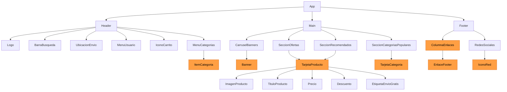

Pruebas ValidarPin:
*** Ejecución Iniciada. ***
Ingresa tu pin
> 2345
Ingresa tu pin
> 3456
Ingresa tu pin
> 7654
Tarjeta bloqueada
*** Ejecución Finalizada. ***

*** Ejecución Iniciada. ***
Ingresa tu pin
> 3456
Ingresa tu pin
> 2580
Bienvenido
*** Ejecución Finalizada. ***

--------------------------------------------------------------------------------------------------------------------------------------------------------------------------------

Tabla de traza de CajeroParqueadero:

| VUELTA          | VALOR | TOTAL | CARROS | LEE  |
|:---------------:|:-----:|:-----:|:------:|:----:|
| Antes del ciclo | 4000  | 0     | 0      | -    |
| 1               | 4000  | 4000  | 1      | 8000 |
| 2               | 8000  | 12000 | 2      | 2000 |
| 3               | 2000  | 14000 | 3      | 0    |
| Sale            | 0     | 14000 | 3      | -    |

Prueba:
*** Ejecución Iniciada. ***
Valor cobrado (0 para cerrar caja):
> 4000
Valor cobrado (0 para cerrar caja):
> 8000
Valor cobrado (0 para cerrar caja):
> 2000
Valor cobrado (0 para cerrar caja):
> 0
Carros atendidos: 3
Total recaudado: $14000
*** Ejecución Finalizada. ***

---------------------------------------------------------------------------------------------------------------------------------------------------------------------------

Prueba Calificaciones:
*** Ejecución Iniciada. ***
Nota del estudiante 1:
> 3.5
Nota del estudiante 2:
> 2.8
Nota del estudiante 3:
> 4.9
Nota del estudiante 4:
> 3.0
Nota del estudiante 5:
> 4.2
Promedio: 3.68
Aprobados: 4
Nota mas alta: 4.9 y nota mas baja: 2.8
Hay estudiantes en refuerzo
*** Ejecución Finalizada. ***

-------------------------------------------------------------------------------------------------------------------------------------------------------------------------------

Tabla de traza de Piramide:

| FILA | ESPACIOS | ASTERISCOS |
|:----:|:--------:|:----------:|
| 1    | 3        | 1          |
| 2    | 2        | 3          |
| 3    | 1        | 5          |
| 4    | 0        | 7          |

Pruebas:
*** Ejecución Iniciada. ***
Altura de la pirámide:
> 1
*
*** Ejecución Finalizada. ***

*** Ejecución Iniciada. ***
Altura de la pirámide:
> 4
   *
  ***
 *****
*******
*** Ejecución Finalizada. ***

*** Ejecución Iniciada. ***
Altura de la pirámide:
> 6
     *
    ***
   *****
  *******
 *********
***********
*** Ejecución Finalizada. ***
--------------------------------------------------------------------------------------------------------------------------------------------------------------------------------

Prueba FacturaRestaurante:

*** Ejecución Iniciada. ***
Precio del producto (0 para terminar):
> 25000
Cantidad:
> 2
Precio del producto (0 para terminar):
> 12000
Cantidad:
> 1
Precio del producto (0 para terminar):
> 0
------ FACTURA ------
Subtotal: 62000
Impuesto (8%): 4960
Propina (10%): 6200
Total: 73160
*** Ejecución Finalizada. ***
--------------------------------------------------------------------------------------------------------------------------------------------------------------------------------

## Árbol de componentes: Mercado Libre (página principal)

### Componentes que se repiten

| Componente        | Dónde se repite                                   |
|-------------------|---------------------------------------------------|
| `ItemCategoria`   | Una vez por cada categoría del menú               |
| `Banner`          | Una vez por cada slide del carrusel               |
| `TarjetaProducto` | Muchas veces en Ofertas y en Recomendados         |
| `TarjetaCategoria`| Una vez por cada categoría popular                |
| `ColumnaEnlaces`  | Varias columnas en el footer                      |
| `EnlaceFooter`    | Muchos enlaces dentro de cada columna             |
| `IconoRed`        | Un ícono por cada red social                      |
